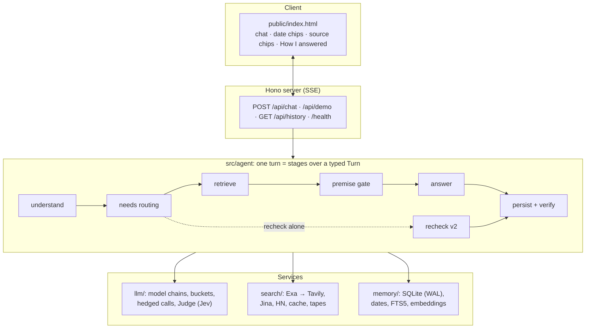
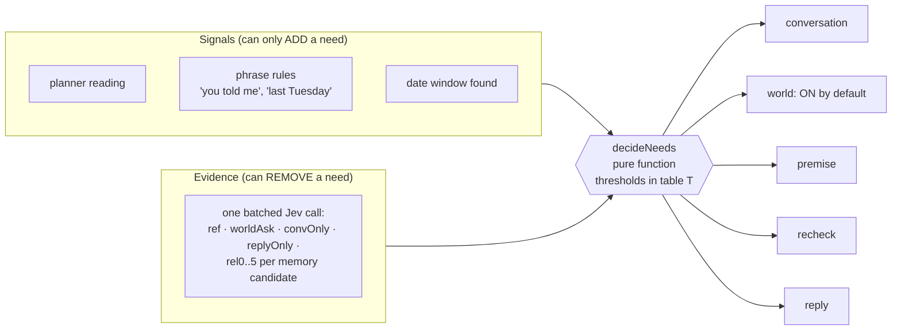
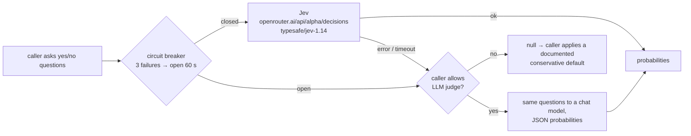
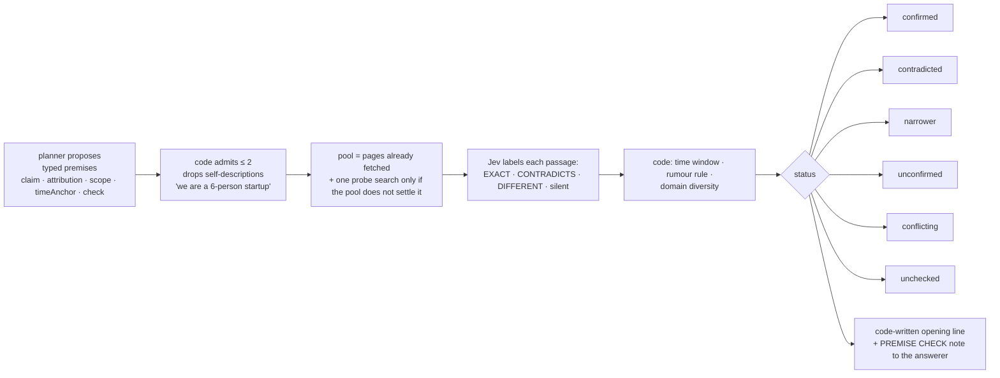
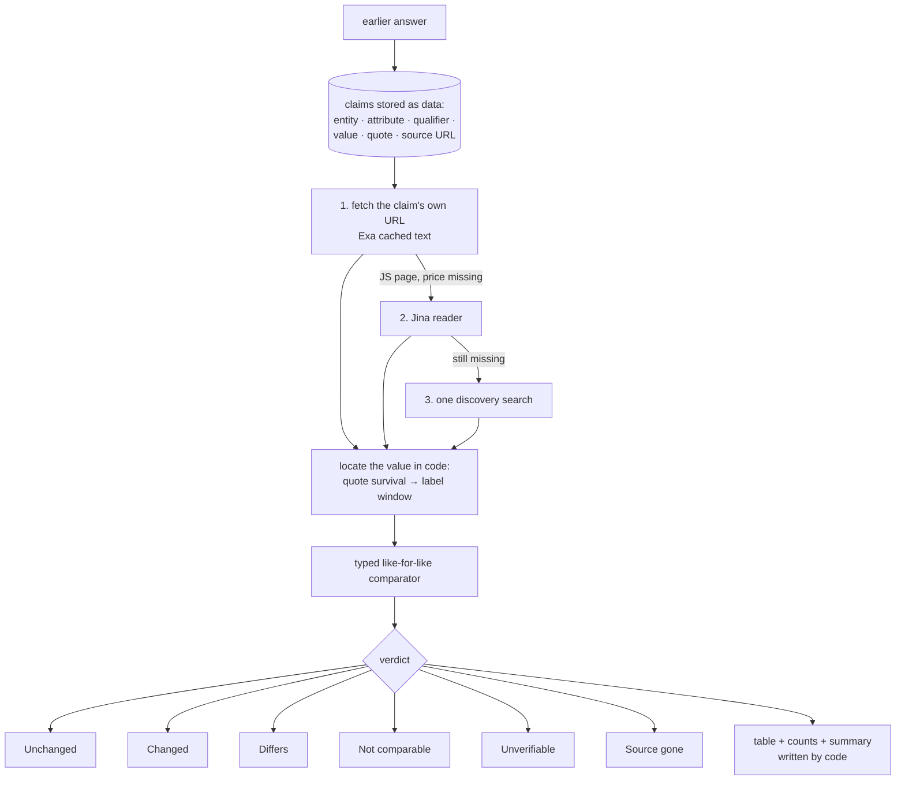

# Architecture

This is the long version of [`DESIGN.md`](DESIGN.md). Each section covers one decision: **what it does, how it works, why, what else I considered, what I rejected, and what I would do with another week.** The "why" comes from [`evals/FINDINGS.md`](evals/FINDINGS.md); `F-nn` is a finding ID in that log. [`TESTING.md`](TESTING.md) says how each claim was measured.

**A note on evidence.** Every number below is a number I logged in `FINDINGS.md` on the day. I did not re-run any suite while writing these documents (the suites and their harnesses are described in `TESTING.md` and were removed from the submission). Every statement about the code was checked against the source. Everything was built and measured on **free-tier models**; read every score with that in mind.

**Contents**

1. [The shape of the system](#1-the-shape-of-the-system)
2. [Layers, and the rule that keeps them honest](#2-layers-and-the-rule-that-keeps-them-honest)
3. [Needs routing](#3-needs-routing)
4. [Jev, the judge layer](#4-jev-the-judge-layer)
5. [Premise gate](#5-premise-gate)
6. [Recheck v2](#6-recheck-v2)
7. [Verification after streaming](#7-verification-after-streaming)
8. [Memory and time](#8-memory-and-time)
9. [Models, limits and speed](#9-models-limits-and-speed)
10. [Search](#10-search)
11. [Answer guards and safety](#11-answer-guards-and-safety)
12. [With another week](#12-with-another-week)
13. [What the code guarantees, and what it does not](#13-what-the-code-guarantees-and-what-it-does-not)

---

## 1. The shape of the system

The brief asks for three things: **answer fast, get things right, remember what you asked and when.** Every component exists because one of those three breaks without it. The test I applied to each part: *what breaks, measurably, if I remove it?*

The server is a thin Hono app. `Agent.handle` in `src/agent/pipeline.ts` (171 lines) runs the stages in order over one typed `Turn` object (`turn.ts`):

`understand` → `needsRoute` → `boundaryNotes` → *(recheck alone: premise gate, then `recheckV2`)* → `retrieve` → `runPremiseGate` → `answer` → `persist.finish` + `postVerify`

**Why one SQLite file and one process.** The brief says `npm install` then `npm run dev`. `node:sqlite` is built into Node, so there is no native build to fail on an unusual Node version, and no database server to start. WAL mode lets the post-answer writers run while the next turn reads.

**One tool.** The only thing that reaches the outside world is web search. Exa, Tavily, Jina's page reader and HN Algolia all sit behind one `SearchRouter`, so the model sees one capability. Memory is the agent's *own state*, not a second tool. See the "model-called memory tool" row in [§8](#8-memory-and-time).

---

## 2. Layers, and the rule that keeps them honest

**The principle: models propose, code decides.** A model may *suggest* that a message refers to your history, that a premise needs checking, or that two figures are the same. Code, using scored evidence, makes the decision, and code writes every sentence that states a date, a number or a fact about your history.

This is enforced, not just stated. `test/layers.test.ts` has two rules:

1. The **pure** modules may not import an LLM, search, store or stage at runtime. They are: `recheck/values.ts` (the comparator), `memory/temporal.ts` (dates), `agent/history.ts`, `needs.ts`, `routing.ts`, `text.ts`, `signals.ts`, `guard.ts`, `answer-input.ts`, `util/url.ts`.
2. Lower layers (`search`, `memory`, `llm`, `recheck`, `util`) may never import `agent/`.

| Decision | Who does it | Why |
|---|---|---|
| What the user means (past reference? premise? recheck?) | planner proposes → `decideNeeds` decides | A thin planner then costs detail, not a leg ([F-79](evals/FINDINGS.md), [F-95](evals/FINDINGS.md), [F-101](evals/FINDINGS.md)) |
| "Last Tuesday" → dates | `chrono-node` plus rules in `temporal.ts` | Weak models invent date ranges |
| Is a past turn relevant? | Jev scores, thresholds in one table | Probabilities fit thresholds |
| Is a number in the answer in the source? | code (`verify.ts`) | Decision models are weak at quantities, dates, negation |
| Did the price change? | typed comparator + timing rule (`values.ts`, `v2.ts`) | F-120, F-122 |
| Premise verdict | Jev labels → code applies time window and rumour rule | F-96 |
| "On Tue you asked…" lines, tables, counts | code | Nothing to hallucinate |
| Prose answer to a world question | model | The one thing models are good at |

**Considered and rejected.** (a) A framework (LangGraph, an agent SDK): durability and graphs I do not need, and the design would hide behind the framework. (b) A multi-agent orchestrator: roughly an order of magnitude more tokens for a gain that parallel calls inside one pipeline mostly capture, on a free tier with an 8k tokens-per-minute budget. (c) Provider built-in search: no date filter, no control over fan-out, caching or logging, and no page text to re-read later.

**Another week:** replace the import-rule test with a dependency-cruiser style check in CI, and add a "pure functions only" lint for the pure list.

---

## 3. Needs routing

### What it does
A message can carry several intents. "You told me Skype was shut down. When exactly, and what replaced it?" refers to our conversation, makes a claim to check, **and** asks about the world. A turn is therefore a **set of needs**: `conversation`, `world`, `premise`, `recheck`, `reply`. Code writes one section per need.

### How it works (`src/agent/needs.ts`, `routing.ts`, `stages/route.ts`)
- **`decideNeeds` is a pure function** from a bag of signals to the need set, with a `why[]` trail that the UI shows under "How I answered". Every branch has a unit test (`test/needs.test.ts`).
- **Signals only add.** The planner's `pastRef`, a phrase rule ("you told me", "first question"), a date window, or "you told me X" each raise `conversation`.
- **Evidence removes.** A weakly backed reference (a bare time phrase, or the planner alone) is dropped when Jev says the message is not about our chat. Explicit cues and "you told me X" are immune to that drop.
- **The world leg is on by default.** It is switched off only by **agreement**: no premise, no world question from the planner, and Jev says our record alone answers the message (`CONV_ONLY 0.7`, or `0.8` when the planner weakly said "factual").
- **Reference is not relevance.** A related old chat that nobody referred to stays quiet context. It never gets an "On Tue you asked…" line. That one separation is what keeps always-on memory from reintroducing the "unrelated history quoted" failure (F-56, F-90, F-106).
- **Memory gathering is a union**: this chat, the subject, and the date window. The window is a hint, not a filter. One batched Jev call scores each candidate's relevance (`rel0..5`) alongside the questions above.
- **Thresholds live in one table, `T`**: `REF_ADD 0.7`, `REF_KEEP 0.5`, `REF_CLEAR_NO 0.3`, `CONV_ONLY 0.7`, `CONV_ONLY_STRONG 0.8`, `WORLD_ASK_NO 0.4`, `WORLD_ASK_YES 0.5`, `REPLY_ONLY 0.7`. They were tuned on the development split only.
- **The conversation section is written by code.** "On Tue 10 Nov you asked…" and the honest "I have no record of that" never go through a model.

### Why (findings)
The original design picked **one route** per message (`chat | memory | quick | research | recheck`). The route decided which evidence was fetched at all, and `memory` fetched no web evidence. Once the label was wrong nothing downstream could recover the dropped intent, because its evidence was never collected. About ten findings were patches on that one lossy step: F-1, F-10, F-36, F-56, F-58, F-88, F-89, F-90, F-97, F-99. Each guard fixed one direction and endangered the other (F-89's first fix broke "What did I ask you on 2 November?").

The cost asymmetry decided the design: **a missed leg is a wrong or unsearched answer (S1); an extra leg costs about a second and one search (S3).** So activation is a monotone OR over cheap signals, and *use* is decided by evidence.

### Result
Frozen set `heldout4` (63 items: 10 intent types × 3 history conditions, test split 43, written before the code and run once, F-101):

| Routing | Test items passed |
|---|---|
| One route per turn | 20/43 (47%) |
| Needs routing | 25/43 (58%) |

n=43 gives roughly ±15 points, so the claim is *direction*, not size. A shortcut I tuned on the dev split was later exposed by a live failure and fixed (F-105, F-106). **That fix was not re-measured on a fresh set.**

### Considered
| Option | Verdict |
|---|---|
| **Query fan-out / decompose and run legs in parallel** (LLMCompiler, ReWOO, "AI Mode"-style fan-out) | Direction adopted: run legs in parallel. Not the full DAG. |
| **Always retrieve, then let an evaluator decide what to use** (CRAG-style) | Core pattern adopted for memory admission. Jev is the evaluator. |
| **Sub-question DAG** (Self-Ask, Least-to-Most) | Rejected: moves the single point of failure from "one label" to "one decomposition"; roughly doubles planner output on an 8k TPM budget; adds a sequential hop. |
| **Embedding-based semantic router** | Rejected: the same single-label structure. Compound queries collapsing to one route is its known failure mode. |
| **RouteLLM-style learned router** | Not applicable: it routes between *models*, not evidence legs. |
| **Adaptive-RAG complexity routing** | Kept only for *depth* (quick vs research is a budget), not as a gate on evidence. |
| **Jev as the primary router** | Rejected first (it does not save time: the planner still has to write the queries). Later adopted as the *evidence layer* beneath the router (F-90, F-101). |
| **More regex guards** | Rejected after the fifth one. Regexes stay as add-only signals, so they cannot hurt in the dangerous direction. |

### Another week
A fresh routing set (the current one is spent for tuning), and the planner-degradation arm I designed but did not run: score both builds with the normal planner, the small fallback planner, and no planner. The claim "a thin reading costs detail, not legs" deserves that direct test.

---

## 4. Jev, the judge layer

### What Jev is, and why it is the right tool here
[Jev](https://openrouter.ai/typesafe/jev-1.14) (`typesafe/jev-1.14`, served through OpenRouter's Decisions API) is a small **decision model**: you give it a passage (state) and yes/no questions, and it returns a **probability** for each (the vendor describes it as calibrated; I have not verified that), in about half a second. It does not write prose.

That is exactly the shape this agent needs in a dozen places. Nearly every hard question in the pipeline is a *yes/no judgement about evidence*, with a threshold that code can apply:

| Question asked of Jev | Decides |
|---|---|
| Is this old turn about the same subject as the message? | what history may be quoted |
| Is the message asking about our conversation itself? | the `conversation` need |
| Does it ask about the world beyond our record? | whether to search |
| Can the previous reply alone answer it? | the `reply` need |
| Does this page state this exact event, contradict it, or describe something different? | premise status |
| Is this claim fully supported by its cited passage? | the verification badge |
| Does this news item report a specific change or launch? | what counts as "since then" |
| Is this recalled-by-similarity turn actually relevant? | semantic recall admission |

A free-text LLM judge gives you a sentence; Jev gives you `0.83`, which a pure function can compare with `T.CONV_ONLY`. That is what let me move routing, premise status and claim support out of prompts and into unit-tested code.

**What I did not trust it with.** The vendor says decision models are weak at quantities, dates and negation. So Jev **never sees a number**: figures are masked as `[N]` before it judges a claim, and code proves the figures itself ([§7](#7-verification-after-streaming)). F-31 showed the other side of that rule: a monthly price labelled "/seat/yr" passed, because the numbers matched and Jev never saw the unit, so code checks units too. Dates and time windows are code (`temporal.ts`, the premise time filter).

### How it is wired (`src/llm/judge.ts`, F-109)
One module, one client, one health signal:

- **The default always leans toward doing more**: keep searching, quote less history, mark a claim "unchecked". It never leans toward a confident guess.
- **Health is visible**: `GET /health` and every `done` event carry `judge.degraded`, and the UI says "judge degraded (fallback in use)".
- **It replaced three separate Jev clients** (routing, premise, verifier) plus the verifier's own LLM fallback, so there is one place to read, test and break.
- **Semantic recall** (`memory/semantic.ts`) uses a second pattern, *similarity proposes, Jev admits*: `nvidia/nemotron-3-embed-1b` embeddings propose candidates at cosine ≥ 0.25; Jev admits them. Without Jev, a stricter cut-off of 0.42 applies. Embeddings are written in the background and never block a turn.

### Why Jev, and not just a bigger LLM
1. **Numbers beat sentences.** Thresholds need numbers.
2. **Small and fast on the critical path.** About 0.5 s per batched request, one request carrying many questions. A model call that wrote a verdict would cost more and parse less reliably on a free tier.
3. **A different failure mode from the answerer.** The model that writes an answer is the worst judge of it. Jev has no stake in the prose.
4. **Cheap.** The vendor lists $0.042 per million input tokens for Jev 1.13 and says output is free. On the LLM-AggreFact grounding leaderboard the vendor reports Jev 1.13 at 78.7, in the same band as much larger models. **Both figures are the vendor's own and I did not verify them.** The claim I am making is narrower: a small purpose-built judge is competitive for *grounding*, which matches the independent MiniCheck finding that grounding checks work well with small models.

### Honest limits
- **It is an alpha endpoint** with no stated SLA. This is why the breaker, the LLM fallback and the conservative defaults exist, and why they are tested (`test/judge.test.ts`).
- **Its calibration on my routing questions was never measured separately.** The thresholds were tuned on the dev split.
- A degraded Jev costs latency and search spend, not correctness, because every fallback does more work.

### Considered
| Option | Verdict |
|---|---|
| Jev as router | Rejected as the *router*. Kept as the *evidence layer*. |
| Local NLI / grounding model via ONNX | Deferred: a large native dependency against "`npm install` just works", and NLI transfers poorly to noisy web passages. |
| LLM-as-judge everywhere | Kept as the fallback only. |
| No judge, rules only | This is where the project started; see F-79 (23/40 on unseen rewordings). |

### Another week
Measure Jev's calibration (reliability curve per question type) against a hand-labelled set, and re-fit the thresholds from it, instead of from the dev split. Add a local grounding model as a second opinion when Jev disagrees with the LLM judge.

---

## 5. Premise gate

### What it does
Many wrong answers come from a question whose assumption is false: "Why did Apple stop making iPhones?", "My friend says Python 4 came out last month." The gate checks the assumption **before** the answer streams and, when it does not hold, code writes the opening line ("I can't find any report that…"). A confirmed premise stays silent.

### How it works (`src/agent/claims.ts`)

- **Typed premises, not strings.** `attribution` is `presupposed`, `user`, `third_party` or `assistant_past` ("you told me X"). `scope` names the *whole* of what is assumed (the entire product line vs one model; the company's own offer vs a partner's; an approved treatment vs a study; released vs announced). `check` is a neutral yes/no query, never the loaded phrasing.
- **"Related but different" is a first-class label.** That is the failure that mattered. Search returns the nearest real event to a loaded query: one phone model retired, a carrier bundle, a mouse study. The answer then stretches it into the premise.
- **Time and reliability are code.** An EXACT page published before the premise's time window is reclassified as DIFFERENT (an earlier occurrence). A single non-official source that sounds like a rumour (`RUMOUR_RE`: "reportedly", "expected to", "leak"…) cannot confirm.
- **Statuses**: `confirmed`, `contradicted`, `narrower`, `unconfirmed`, `conflicting`, `unchecked`. Any failure yields `unchecked`, so the gate is never worse than having no gate.
- **Verdicts are cached per day**, so a premise already confirmed today is not re-checked.
- **Self-descriptions are dropped.** What users say about themselves is context, not a claim to check (F-119).

### Why
The investigation (F-70, F-77, F-78, F-79 and the heldout2 failures) showed that the mistake sits *between the question and the evidence*. The stretched sentence is supported by its passage, so the post-answer verifier cannot catch it. And an instruction to "check the premise" in the prompt is a weak lever for small models. Making the premise an explicit object that is retrieved for neutrally, judged by a classifier with a "related but different" option, aggregated with dates in code, and enforced by a code-written frame fixes it by construction.

### Result
Frozen set `heldout3`: 24 seeds (8 premise types × 3 polarities: false / true / narrower) × 3 attributions (presupposed / third party / "you told me") = 72 items. Hand-written wording, 48 gold facts with URLs, seeded shuffle, dev 21 / test 51. **Run once, same-day A/B** (F-100):

| | Overall | False premises | True premises |
|---|---|---|---|
| With gate | **31/51 (61%)** | 14/18 | 10/18 |
| Without gate | 21/51 (41%) | 9/18 | 6/18 |

The gate did not increase false alarms on true premises. n=51 means about ±13 points, so the gap is real but its size is not precise. The 61% is *not* a good absolute score: 8 of 18 true premises are still being handled poorly. That is the residual I would work on first.

### Considered
| Option | Verdict |
|---|---|
| **A. Structured self-check by the answerer** (it emits its own premise verdict first) | Rejected: the model that stretches the evidence would grade its own stretch. |
| **C. Answer first, audit and revise** | Rejected as the primary mechanism: a wrong lead is already on screen, and retracting looks broken. A slice survives as the post-display backstop. |
| Prompt rule only ("check the premise") | The starting point. Small models copy the *form* of examples more reliably than they follow rules. |
| Probe searches for every premise, always | Rejected for cost. The gate reuses pages already fetched and searches once more only if the pool does not settle it. |
| Local NLI | Deferred (see §4). |

Related work I leaned on: presupposition-verification research (Kim et al. 2021, arXiv 2101.00391; CREPE, arXiv 2211.17257) found that detecting presuppositions is easy and *verifying* them is hard, mostly because retrieval returns near-misses; FEVER's three labels plus AVeriTeC's fourth "conflicting/cherry-picking" label motivate the "different" option.

### Another week
Numeric presuppositions ("the *six* living prime ministers") are left to the number checks, and opinion presuppositions ("why is X the best") to normal answering. A larger, balanced true/false set with fresh topics, and a measured threshold sweep on the stance probabilities.

---

## 6. Recheck v2

### What it does
"What did I ask on 3 Nov, is it still correct?" The agent re-reads **each earlier claim where it first found it**, compares the old and new value in code, and writes the table and the summary itself.

### How it works (`src/recheck/v2.ts`, `values.ts`)
- **Claims are data.** After a world answer is saved, claims are recorded in the background (migration v4), with `claimsFromAnswer` as a fallback for older turns. Each has the value, the exact quote and the URL.
- **Re-observe, do not re-search.** We know *where* the fact lived. The ladder is the claim's own page (Exa cached text), then Jina's rendered fetch for JavaScript pages, then one discovery search. Freshness follows the claim's age rather than a live crawl every time.
- **Locate in code first**: quote survival (the old quote is still on the page → Unchanged, with proof), then a label window around the vendor/plan name. A model only picks a line number from a numbered window in the leftover cases, and never types a figure.
- **A typed comparator** (`compareValues`) compares money, versions, dates and names only under the same qualifier (plan, cadence, unit, region). It converts month ↔ year, reads `€1.299,00` correctly, uses precision-aware tolerance ("about $60" equals $59.99), and treats a >20× difference as probably another tier.
- **"Changed" needs timing evidence.** Either the old quote was on the page when we read it and is gone now, or a dated item since then names the brand, states the new value and reports a change nearby. Otherwise the verdict is **"Differs: my earlier figure may have been wrong"**. This distinction mattered (F-120): an earlier CRM answer had quoted a base fee as a plan price, and the naive diff called that a price change.
- **Code writes everything with a figure in it**: the table, the counts ("0 of 5 changed; 3 couldn't be verified"), the summary sentence, and the dated "since then" list. It never says "nothing changed" above rows it could not check.
- **A premise in the same message** ("since Amazon bought Spotify…") is checked first and framed above the table.

### Why
The old recheck asked one model call to do five jobs at once (find "then", find "now", choose a citation, pick a verdict, write a summary), with code only vetoing afterwards. Failure analysis found one root cause, in several forms: **the model was allowed to state facts in prose and to choose its own citation separately from its value.** The fix is a verification task over stored, typed claims in which models only choose between options that code has already grounded.

Findings that shaped it: F-22 (21 searches and still Unverifiable), F-87 (dated guides counted as news), F-94 (tier confusion, "€37,50" read as 37), F-120 (Changed vs Differs), F-121 (a comparison page counted as change evidence), F-122 (comparator errors found in review).

### Result
The recheck scenarios sit inside the 44-case development set, which I tuned against, so they show the design works, not that it generalises. The brief's CRM recheck ended with "0 of 5 changed; 3 couldn't be verified" plus one dated vendor event (F-69). That is the honest shape of the answer. **I do not have a frozen held-out recheck score**; the recheck design was validated by live runs, unit tests (`recheck-values.test.ts`, `recheck-timing.test.ts`) and the dev set.

### Considered
| Option | Verdict |
|---|---|
| **A. Harden the old design** (quoted spans from the model, code checks) | A good stopgap, and its pieces are reused. Still ends at "search again and hope". |
| **B. Re-answer and diff** | Rejected: 6–12 s, doubles Groq spend, and any error in the new answer reports as a "change". Search drift misaligns the claims. |
| **D. Background monitoring** | Rejected for now: burns free daily quotas on claims nobody asks about, plus a scheduler. One cheap piece kept: validate a new claim's recipe once, in the background, while the page is fresh. |
| Whole-page content hashes for change detection | Rejected: pricing pages change on every load (A/B tests, geo, tokens). Quote survival is a region hash with proof. |
| `maxAgeHours: 0` live crawl by default | Rejected after probing: slow and failed in two of three probes. |
| Exa `summary.schema` as the extractor | Rejected: an unattributed LLM output, the same problem one hop away. |
| The LLM deciding invalidation (per-claim prompts) | Rejected: code decides under the qualifier key. |
| Wayback in the foreground | Rejected: 3–7 s. **Not built at all**, even in the background. |

### Limits
JavaScript-rendered vendor pages sometimes leave a price **Unverifiable** even after the Jina rung (F-22, F-94). "When did it change?" is only bracketed between the earlier answer and the observation, unless a dated item attaches to the row.

### Another week
Bitemporal claims (`valid_from` / `valid_to`; today a changed value writes a superseding claim but does not store the validity interval), a background recipe check on every new claim, Wayback in the background for the "when", and a frozen recheck set with an ablation.

---

## 7. Verification after streaming

### What it does
After the answer has streamed, every cited sentence is checked and shown as a badge. The answer text is never edited. The results go into the ledger and into the next turn's context.

### How it works (`src/agent/verify.ts`)
1. **Code splits** the answer into cited claims (a boundary is `.!?`, then the `[n]` chips, then whitespace).
2. **Code proves every number** against the cited page: direct matches, derived products and sums, and **unit mismatches** (a monthly price labelled "/seat/yr", F-31).
3. **Jev judges the masked claim** ("is this claim fully supported by this passage?") with numbers replaced by `[N]`.
4. Statuses: `verified`, `weak`, `unsupported`. The UI shows line-level marks (worst status per line wins) and lists "figures not found in the cited source".
5. **Answers written by code skip the Jev re-judge** (`codeWritten`), since the table cells were taken from located values.
6. **Unbacked citations are removed in code** while streaming (`dropUnbackedCitations`): an `[n]` that points at no retrieved source, or a link to an unknown URL.

### Why
- *Gate vs label.* An early design only let verified claims into the ledger. The audit caught the flaw: "what did I ask on the 3rd, is it still correct?" has to cover **everything** the agent said, including the shaky parts. So every claim is stored with its support level, and only verified, quote-anchored values become re-check baselines.
- *Why after streaming.* Holding the answer back until it is checked would cost the streaming latency the brief asks for. Streaming plus post-display verification is the trade-off I chose (it is also why the premise gate runs *before* the answer).
- *Why not edit.* Rewriting a displayed answer is a worse experience than an honest badge, and rewriting a stored assistant message breaks the append-only history.

### Result and cost
Verifier false alarms on correct answers: **2 of 54** (F-78). The residual failures in the last runs were mostly claims the verifier flagged, one unsupported figure each (F-104). Those are shown to the user, which is the intended behaviour. The cost is that a flagged line shows up even when the answer was fine, a trade I accepted.

### Another week
A per-claim confidence (source authority, corroboration, recency) shown on each chip rather than three states; quote deep links (`#:~:text=`) built from the number proofs (rejected for now because evidence is search snippets, so links would often highlight nothing).

---

## 8. Memory and time

### What it does
Every turn is stored. "What did I ask last Tuesday?" resolves the date in code, recalls what was asked, and answers with a line written by code. If the date is ambiguous, the UI says so.

### How it works (`src/memory/store.ts`, `temporal.ts`, `semantic.ts`)
- **Schema.** `turns` + `turns_fts` (FTS5, porter stemming), `sources`, `turn_sources`, `entities`, `entity_mentions`, `collections`, `collection_items`, `claims`, `claim_sources`, `verifications`, `search_cache`, `turn_vectors`. Migrations run through a `schema_version` table (currently v8).
- **Dates are deterministic.** `resolveTemporal` uses `chrono-node` with rules. "Last Tuesday" yields **two** candidate windows, the UI shows a date chip ("Read 'last Tuesday' as Tue 3 Nov · Use Tue 10 Nov"), and "No, the other one" resolves back into the pending question (`clarifyDate`).
- **Recall is a union**: this chat, the subject, the date window, FTS5 over turns, and semantic recall when lexical recall finds nothing. Jev admits candidates; unadmitted ones are never quoted.
- **A date with nothing on record** looks the topic up on other dates ("Nothing on Tuesday, but you asked about Postgres hosting on Monday. Want me to check that one?").
- **History is replayed with timestamps.** Earlier turns carry sent-time stamps, the latest reply is nearly whole, and sites used are listed, all within a size budget (`history.ts`). "Give me your recommendation in two lines" is answered from the previous reply and its own sources, with the same `[n]`, with no new search (the `reply` need; first token 1.5 s vs 4.2 s in the live check, F-123).
- **Shortlists and decisions are data**, extracted in the background. A recheck reads shortlist items directly instead of parsing old tables.
- **Ownership.** Every turn has an `owner`; all cross-history recall filters by it (F-114). On localhost there is one local owner; on a network address, each browser gets an HttpOnly cookie id. The request cap is 32 KB.
- **Honest failure.** A turn is `pending` until its answer exists. Recall and history show only completed turns.

### Why
Memory is where "remembering what you asked and when" is won or lost, and dates are where small models fail. Time-aware recall and absolute dates in every record are what the memory work I read (LongMemEval and its successors) found to matter most, and weak models invent date ranges. So resolution must be deterministic and able to return "no range" (a pure function with tests: `test/temporal.test.ts`).

### Considered
| Option | Verdict |
|---|---|
| **Mem0** | Rejected: its UPDATE/DELETE overwrites exactly the history this product needs. |
| **Zep / Graphiti** | Right idea (bitemporal facts), but needs a graph database. I kept the idea (event time ≠ conversation time) and not the dependency. |
| **Mastra observational memory** | Rejected: lossy. An exact past price gets paraphrased away. |
| **MemGPT/Letta-style model-called memory tool** | Rejected: the model has to remember to call it. Deterministic pre-retrieval is testable, and keeps "one tool" literally true. |
| **Vectors only** | Rejected: recall is largely temporal and lexical. Vectors are an additional, Jev-admitted channel. |
| **Local embedding model** | Rejected: hundreds of MB of `node_modules`. A hosted embedding is optional and background-only. |
| **`better-sqlite3`** | Rejected: native build risk. `node:sqlite` is built in. |

### Limits
Embedding recall needs `NVIDIA_API_KEY`; without it, recall is lexical + date only (stated at boot). Semantic similarity is computed in JavaScript over stored vectors, which is fine for a personal history and wrong for a million turns.

### Another week
`sqlite-vec` plus reciprocal-rank fusion across lexical, date and semantic channels, a cross-encoder rerank, a user-facing `/memory` and `/forget`, and commitment capture ("I'll decide by Friday") surfaced at the next session.

---

## 9. Models, limits and speed

### What it does
Several jobs need a model (`planner`, `answer_quick`, `answer_deep`, `extractor`, `verifier_llm`). Each has an **ordered chain** in `config.ts`. The chains spread jobs across models because each Groq model has its own token budget.

### How it works (`src/llm/client.ts`)
- **Per-model token buckets** (Groq 8,000 TPM), **daily quotas**, and **circuit breakers**. A daily-limit 429 is parsed ("try again in 20m30s") and the model is skipped until then (F-49).
- **Hedged calls**: for the planner and the recheck extraction, a twin request goes to a different model after 1.8 s, and the first reply wins. **Never for streamed answers.** This cut the planner tail (p50 0.9 s, but p95 3.4 s and max 7.8 s before it, F-125).
- **Stream idle timeout** 15 s; an idle stream gets a "cut short" note.
- **Answers wait up to 35 s for a rate-limit budget** instead of failing with "all models busy" (F-43).
- **NVIDIA calls disable hidden reasoning** (`enable_thinking=false`), after a fallback model spent its whole token budget thinking and returned nothing (F-50).
- **Provider probe**: `probe()` marks chain models that the provider does not list as unavailable.
- **Deadlines per route** (`DEADLINES_MS`): memory 8 s, quick 10 s, research 45 s, recheck 45 s. Retrieval stops 4 s early to leave room for the answer.
- **The user sees status early**: "Understanding the question", "Searching: …", then tokens.

### Why
Speed was a requirement, and the free tier made it a design problem. A model-driven tool loop costs a full model pass just to decide to search, then another to answer. A small planner replaces that first pass and writes the queries too, so most turns need two model round-trips.

### Result (free tier, as logged)
First token p50 **2.2 s**, p95 4.7–5.4 s (F-104, F-119). With Exa unavailable and only Tavily + Jina: p50 5.2 s and 27/44 (F-102), which is the degraded floor.

### Limits
Free-tier capacity shaped everything: Groq's **200k tokens per model per day** is shared by every key from one account (F-49, F-95); roughly 120–150 full answers a day. The NVIDIA fallback is slower (F-81). I never measured a paid or frontier model.

### Considered
| Option | Verdict |
|---|---|
| One strong model for everything | Not possible on free tiers at this latency. |
| Self-hosting a model | Out of scope for `npm install`. |
| Voting the router N times | Rejected: N× tokens on an 8k TPM budget. The union of independent signals is a cheaper ensemble. |
| Persisting model skip-times across restarts | Rejected: the first call after restart fails fast with a 429 and the model is skipped. Not worth a table and a migration. |

### Another week
Run the same suites on a paid tier and publish the difference. Measure rather than estimate each hedge's win rate.

---

## 10. Search

### What it does
One `SearchRouter` presents web search as one tool.

### How it works (`src/search/router.ts`, `tape.ts`)
- **Exa first, then Tavily** if Exa errors or runs out. **Jina's reader** for JavaScript pages, **HN Algolia** for dated release signals.
- **A `search_cache` with a TTL by volatility**: live 5 min, fast 1 h, slow 24 h, stable 7 d.
- **An Exa 402 (credits gone) switches Exa off for 6 h**, so one dead provider does not add latency to every turn (F-102).
- **Rerank in code** (`retrieval.ts`): canonical URLs, dedupe, official-domain and intent-overlap boosts, per-entity evidence slots for rechecks (F-22), and evidence ordered oldest to newest with each source labelled by its date.
- **Per-turn search cap** (`TURN_SEARCH_CAP` = 40) and a bounded follow-up round for named entities no page covers (at most two searches).
- **Record/replay tapes** (`SEARCH_TAPE`, `SEARCH_TAPE_DIR`, default `data/tapes/default`): search results can be recorded once and replayed for free, which makes evaluation reruns cheap and deterministic.

### Why
Search is where "get things right" meets the real world. Dates on sources matter (an old article must never be used as "now"), pages must be re-readable later (so page text is kept), and the agent must degrade, not die, when a provider fails.

### Not built
There is **no speculative search prefetch**: retrieval starts only after the needs are decided. (An early version did prefetch and wasted searches on chat turns, F-8; the `retrieveCtl` abort that cancels retrieval when the needs decide no web is required is what remains.) There is **no SSRF-hardened fetcher**: the agent only fetches URLs returned by search providers, and `util/url.ts` holds only URL helpers. If this were exposed to untrusted users, that would need work.

### Another week
ETag/`If-Modified-Since` revalidation, a learned expiry per attribute, and a cross-encoder rerank.

---

## 11. Answer guards and safety

### What it does and how (`stages/answer.ts`, `guard.ts`)
- **Streaming output guard**: stops and retracts on prompt leaks (8-gram match against the system prompt), bylines, and degenerate multi-script output.
- **`unusable()`** triggers one retry on a different model (`avoidModels`).
- **`ACTION_CLAIM_RE`**: if an answer claims to have performed an action (booked, sent, bought), the UI shows a warning. The agent has no side-effecting tools.
- **The user's format wins**: "in two lines", "as a table".
- **Untrusted data**: retrieved text is marked as data, not instructions.
- **Owner scoping and a 32 KB request cap** (see §8).

### Why
These came out of the red-team suite, where attacks escalate over several turns. The original failures went from 12 to 1 to 0 (F-48, F-55). The remaining grader complaints were about the grader, not the agent (F-41, F-42).

### Not built
A **prompt-injection firewall** (a classifier in front of retrieved text). I deferred it because the agent has no tools with side effects, so the blast radius of an injection is a bad answer, not an action; and the obvious classifier is a large native dependency. It is the first item below.

---

## 12. With another week

In the order I would do them, each checked against the code to be *not built*:

1. **Measure Jev's calibration** and re-fit every threshold in `T` from a labelled set, not from the dev split.
2. **A fresh frozen set per area**, and the **planner-degradation arm** (normal planner / small planner / no planner).
3. **An ablation table**: search only → + memory → + Jev → + premise gate → + recheck v2, using recorded search tapes so each arm costs no search credit.
4. **Run on a paid tier** and report the free-tier gap.
5. **Prompt-injection firewall** for retrieved text.
6. **Proactive nudges**: a scheduled recheck of high-volatility claims that tells you when a price you were quoted changes.
7. **`sqlite-vec` hybrid recall** with rank fusion and a cross-encoder rerank.
8. **Wayback in the background** to date changes; ETag revalidation; learned expiry.
9. **Bitemporal claims** and a user-facing `/memory` and `/forget`.
10. **SSRF-hardened fetcher** before any public deployment.

---

## 13. What the code guarantees, and what it does not

**Guaranteed by code (and tested):**
- A date in an answer about your history was computed, not generated.
- Every "On … you asked" line comes from a stored turn, or the agent says there is no record.
- Every cited `[n]` points at a retrieved source; unknown ones are removed.
- Every figure in a table of re-checked prices was located on the page, and "Changed" needed timing evidence.
- A turn that loses its planner, its judge, or a search provider still produces an answer, and says what it could not check.
- The deciding modules cannot import a model, a search client or the database.

**Not guaranteed:**
- That the answering model's prose is right. It is checked after display, and flagged, not blocked.
- That search surfaces the page that settles a premise. The best outcome then is "unconfirmed".
- That a vendor's page lets us see the price (JavaScript rendering).
- That any score here holds on other models, other topics, or a larger history. See [`TESTING.md`](TESTING.md).
