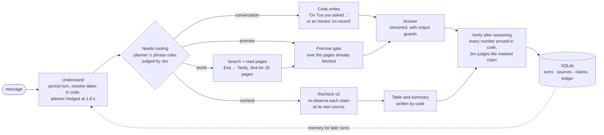

# chat-agent

A chat agent with **one tool, web search**, that answers fast, checks its own work, and remembers **what you asked and when**.

It is written in TypeScript on Node, runs from a single SQLite file, and starts with `npm install && npm run dev`.


## The idea in four lines

1. **Models propose, code decides.** Dates, numbers, comparisons, thresholds, citations and every sentence about your history are produced by plain, unit-tested code. Models only read intent, write queries, and phrase an answer.
2. **A turn is a set of needs, not one route.** "You told me Skype shut down. When, and what replaced it?" needs your history, a premise check and a web search at once. Signals can only *add* a need. Only evidence can remove one.
3. **[Jev](https://openrouter.ai/typesafe/jev-1.14) is the evidence judge.** A small decision model (`typesafe/jev-1.14`) answers yes/no questions with a probability. Figures are masked before it judges, and code owns numbers and dates.
4. **Everything the agent says is checkable.** Every number in an answer is proved against its cited page after the answer streams. Earlier answers are re-checked at the page they originally cited, and the result is a table written by code.

Read next: [`DESIGN.md`](DESIGN.md) (one page) · [`ARCHITECTURE.md`](ARCHITECTURE.md) (every decision: how, why, what was rejected, what I would do with another week) · [`TESTING.md`](TESTING.md) (how it was tested, and what the tests cannot show) · [`evals/FINDINGS.md`](evals/FINDINGS.md) (the raw log of 126 findings behind all of it).

---

## Run it

```bash
npm install
cp .env.example .env      # then fill in the two required keys
npm run dev               # http://127.0.0.1:3000
```

Node 22.13 or newer (`.nvmrc` says 22; the suite also passes on Node 26). No Docker, no database server, no native build: storage is Node's built-in `node:sqlite`.

| Key | Required | What it does | Where to get it (free tier) |
|---|---|---|---|
| `GROQ_API_KEY` | **yes** | planner, answerer, extractor | console.groq.com/keys |
| `EXA_API_KEY` | **yes** | primary search and page reads | dashboard.exa.ai |
| `NVIDIA_API_KEY` | no | fallback LLMs, meaning-based recall (embeddings) | build.nvidia.com |
| `TAVILY_API_KEY` | no | backup search provider | app.tavily.com |
| `OPENROUTER_API_KEY` | no | **Jev**. Without it an LLM acts as the judge | openrouter.ai/keys |

Without an optional key the agent still runs and says what it lost, both at boot and on `GET /health` (`degradedFeatures`). Only the two required keys are needed for `npm run dev`.

Optional settings: `PORT` (default 3000), `DB_PATH` (default `data/agent.db`). The server binds to `127.0.0.1`.

Other scripts: `npm test` (176 offline tests, no network, no keys), `npm run typecheck`.

## Try it in two minutes

1. Open the page and press **Load demo history**. It writes four dated conversations into the database (relative to today) **without calling any model**.
2. Click one of the prompt chips, or type your own:

| Ask | What happens |
|---|---|
| *What did I ask you on Wednesday?* | Code resolves the date, reads your history, writes the "On Wed 11 Nov you asked…" line itself. No search, no model for the facts. |
| *Last Tuesday I asked you about Postgres hosting. Has any pricing changed since then?* | "Last Tuesday" can mean two dates. The agent picks one, shows a **date chip** ("Use Tue 10 Nov instead"), re-reads each price at the page it cited, and answers with a Then / Now / Verdict table. |
| *On Monday we shortlisted 5 CRM tools… has any changed pricing or shipped something big since?* | Reads the shortlist back from the saved record, re-observes every price, searches dated news per product, and counts the verdicts in code. |
| *Is the Node.js version you told me on Tuesday still the latest?* | Finds that answer, re-checks the claim at its own source. |

3. Open **How I answered** under any reply. It shows the needs that fired and why, the searches, the premise verdicts and the per-stage timings.


The demo history is not invented: it is real conversations this agent answered on 3–11 Nov 2026 (live search, real sources), mistakes included, re-dated to the same weekdays relative to today (`src/demo/`). Loading it makes no model calls. Answering the chips live needs `GROQ_API_KEY` and `EXA_API_KEY`.

---

## How a turn flows



First token arrives in about **2.2 s** at the median on the last full run (p95 about 5 s), on free-tier models. See [`TESTING.md`](TESTING.md) for what that number is and is not.

## What is unusual here

| | What it does | Why it matters | Detail |
|---|---|---|---|
| **Needs routing** | A turn is a *set* of needs (`conversation`, `world`, `premise`, `recheck`, `reply`). The web leg is on by default and is switched off only when planner, phrase rules and Jev all agree. | A weak planner costs detail, never a whole leg. | [ARCHITECTURE §3](ARCHITECTURE.md#3-needs-routing) |
| **Jev as a judge layer** | One module (`llm/judge.ts`) with a circuit breaker, then an LLM judge, then a conservative default that does *more* work. | A probability fits threshold logic. Free alpha endpoint, so every fallback is tested. | [§4](ARCHITECTURE.md#4-jev-the-judge-layer) |
| **Premise gate** | Checks assumptions in the question ("since Amazon bought Spotify…") against the pages already fetched, then writes the opening correction in code. | On 51 frozen test items, 61% with the gate against 41% without, same day. | [§5](ARCHITECTURE.md#5-premise-gate) |
| **Recheck at the source** | Every earlier claim is stored as data (value, quote, URL) and re-read where it was found. A typed comparator says Unchanged / Changed / Differs / Not comparable. | "Changed" needs timing evidence. Otherwise "my earlier figure may have been wrong". | [§6](ARCHITECTURE.md#6-recheck-v2) |
| **Proof, not trust** | Each number in an answer is proved against the cited page, including sums, products and unit mismatches. | Jev never sees a number, so it cannot be fooled by one. | [§7](ARCHITECTURE.md#7-verification-after-streaming) |
| **Memory as data** | Dates resolve in code. Recall is a union of this chat, the subject and a date window. Semantic recall: similarity proposes, Jev admits. | "Last Tuesday" is ambiguous and the UI says so. | [§8](ARCHITECTURE.md#8-memory-and-time) |
| **Layers enforced by a test** | `test/layers.test.ts` fails if a deciding module imports a model, search or database client. | The "code decides" claim is a build rule, not a comment. | [§2](ARCHITECTURE.md#2-layers-and-the-rule-that-keeps-them-honest) |

## Limits, stated up front

- **Everything was built and tested on free-tier models** (Groq, NVIDIA's free endpoints, free search tiers). I did not measure it on frontier models. Scores and latencies in these docs are free-tier numbers and would move, probably up, with paid ones.
- Free tiers are small. Groq's cap is 200k tokens per model per day, shared by every key of one account, and Exa's free credits ran out mid-evaluation (a degraded mode that is itself tested).
- The held-out sets are small (about ±13 points). The "final" 44-case set was used during development, so it shows health, not generalisation. [`TESTING.md`](TESTING.md) separates the two.
- Jev is an alpha endpoint with no stated SLA. That is why it sits behind a breaker with fallbacks.
- JavaScript-rendered vendor pages sometimes leave a price **Unverifiable** (and the answer says so).
- Not built: prompt-injection firewall, a user-facing "forget" command, proactive alerts. See [§12 of ARCHITECTURE.md](ARCHITECTURE.md#12-with-another-week).

## Repository map

```
src/
  server.ts            Hono server, SSE stream, owner scoping, /health
  config.ts            keys, deadlines, degraded-feature list
  agent/
    pipeline.ts        the whole turn, as stages over one typed Turn
    stages/            route · retrieve · recheck · answer · persist
    needs.ts           decideNeeds(): pure, thresholds in one table
    claims.ts          premise gate
    verify.ts          number proofs + claim support (after streaming)
    guard.ts           streaming output guards
  llm/                 model chains, rate limits, hedged calls; judge.ts (Jev)
  search/              Exa → Tavily, Jina, HN, cache, record/replay tapes
  memory/              SQLite store, deterministic dates, semantic recall
  recheck/             typed values + comparator; recheck v2
public/index.html      the UI (one file)
test/                  176 offline tests (20 files)
scripts/               calibrate-jev.ts, eval-brief.ts
evals/FINDINGS.md      the log
```
