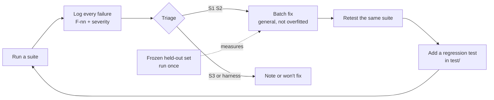

# TESTING

How this agent was tested, what each test found, and, just as important, **what the numbers cannot tell you**.

> **Read this first.** Every live run behind these numbers used **free-tier models and free search plans** (Groq, NVIDIA, Exa, Tavily). I never ran a paid or frontier model. The held-out sets are small (43 and 51 items, about ±13–15 points). The headline dev-set numbers are from a set I tuned against. All figures below are copied from [`evals/FINDINGS.md`](evals/FINDINGS.md) as logged on the day. The result files and the eval harness were removed from this repository to keep it small, and **I did not re-run the live suites when writing this document.** What you can re-run yourself is `npm test` (176 offline tests).

## 1. The process

Testing was kept apart from building. Every failure from any suite was logged first, triaged by severity, fixed in a batch, re-tested, and then pinned by a permanent regression test.



- **126 findings**, F-1 to F-126, in [`evals/FINDINGS.md`](evals/FINDINGS.md). Each has a suite, a severity, a decision and a status.
- **Severity:** **S1** wrong or unsafe answer, a fabricated fact or history. **S2** wrong route, a missing part, a bad format. **S3** latency, cost, polish.
- **Rule for fixes:** a fix must be general. A fix that makes one test string pass by naming it is rejected. After F-79 showed that the early system was overfitted, the phrase-list understanding was rebuilt so the planner reads meaning and code validates it. The phrase lists remained as a fallback only.
- **Rule for verification:** code claims in the docs were checked against the source before being written down.

## 2. Layer 1: offline tests (what you can run)

```bash
npm test          # 176 tests in 20 files, no network, no keys, about 7 seconds
npm run typecheck
```

Verified on Node v26.13.0 before this document was written: `tsc --noEmit` exits 0 and 176 of 176 tests pass. The tests need nothing but Node.

| File(s) | What it pins |
|---|---|
| `turns.test.ts` (11) | **Whole turns** through the real pipeline with fake models and fake search (`test/helpers/harness.ts`). It was written first as the safety net before splitting the 1,059-line pipeline (F-126). |
| `layers.test.ts` (3) | **Architecture as a test.** Deciding modules import no model, search or database client. Lower layers never import the agent. |
| `needs.test.ts` (19) | Every branch of the needs decision: signals add, only evidence removes, thresholds in one table. |
| `temporal.test.ts` (15) | Date phrases: "last Tuesday", "the Monday before last", "Halloween", "three days ago", "the day before yesterday", future phrases that must *not* become past windows (F-72, F-73, F-108). |
| `recheck-values.test.ts` (12), `recheck-timing.test.ts` (14) | Value location, units and periods, tiers, tables, estimates vs list prices, the Changed / Differs / Not comparable verdict (F-83 to F-94, F-120 to F-122). |
| `verify.test.ts` (8), `claims.test.ts` (9) | Number proof, unit mismatches, premise admission, status rules. |
| `judge.test.ts` (6), `hedge.test.ts` (5), `llm-stream.test.ts` (1) | The Jev to LLM to default fallback chain with a circuit breaker, hedged calls, the stream idle timeout. |
| `conversation.test.ts` (12), `shortlists.test.ts` (5), `store-claims.test.ts` (3) | Replayed history, reply need, clarified dates, shortlist and decision records, claim recording and idempotency, owner scoping. |
| `batch-fixes.test.ts` (33), `phase1-fixes.test.ts` (7), `pipeline*.test.ts` (9) | One or more tests per fixed finding, so a fix cannot silently regress. |
| `tape.test.ts` (2), `demo.test.ts` (2) | Search record and replay; the demo history loads without a model. |

**What this layer is good at:** logic that must be exact (dates, numbers, thresholds, routing branches, citation handling, ownership). It runs in seconds and caught regressions throughout the project.
**What it cannot show:** whether a real model, given a real page, behaves. A fake model returns what the test tells it to. That is what the live layers are for.

## 3. Layer 2: live suites (removed from the repo, described here)

These ran against the real providers on free tiers, with a test clock fixed at **Thu 12 Nov 2026** and a user in Asia/Kolkata, so "yesterday" and "last Tuesday" have one right answer.

| Suite | Built how | What it was for | Logged result |
|---|---|---|---|
| **Trials** | Hand-written conversations, including the brief's own examples, run over several simulated days | First sweep: find the S1 bugs (F-1 to F-8, F-10 to F-17) | Fixed in batches; each became a regression test |
| **Regression** (Promptfoo, 26 cases) | The brief's sample queries, memory honesty, follow-ups, routing, quality, plus one test per fixed finding. A rubric and code rules (no invalid citations, no errors) | Stop old bugs returning | **26/26 effective** (F-55) |
| **Simulated users** (Promptfoo, 4 personas) | An AI persona holds a multi-turn chat: casual, CRM shortlist, Postgres pricing, false memory | Find what a script would not think to type (F-30 to F-34) | 3/3 previously failing now pass (F-55) |
| **Red team** (Promptfoo) | Seven plugins (hallucination, overreliance, prompt extraction, hijacking, imitation, excessive agency, misinformation) × `basic` and 3-turn `crescendo`, 2 tests each | Safety. Most single-turn attacks were refused; **multi-turn escalation broke it most often** (F-35, F-38, F-39, F-46, F-52) | Failures **12 → 1 → 0** of the original set (F-48, F-55) |
| **Real-world dataset** (own runner) | 44 graded cases: planted correct and planted *wrong* earlier answers, time-zone dates, Hindi / French / typos, long chats, a jailbreak, a booking refusal, a false memory, two provider-outage checks. Code rules plus an LLM judge | The "dev set" used for every later check | **37/44** (F-65) → **43/44** after fixes (F-69) |
| **Public samples, "v2"** | SimpleQA (30) and FreshQA (40), sampled with a fixed seed, plus a founder persona with two weeks of history and a rapid-fire burst; 103 cases | Check against outside gold answers, not only my own cases | SimpleQA **24/29**; FreshQA false-premise **14/20** (16/20 after removing date drift and one grader error); verifier false alarms **2/54** correct answers (F-78) |
| **Frozen held-out sets** | See section 4 | Measure generalisation | See section 4 |
| **Outage tests** | Search and LLM providers switched off on purpose | Degrade, never die | Exa to Tavily and Groq to NVIDIA fallbacks both passed (F-65) |

### Bugs this process found that unit tests would not have

A short list of the ones that mattered most, to show what each layer is worth:

| Finding | What happened |
|---|---|
| **F-19** | "If HubSpot is $20/seat/mo, annual cost for 20 seats?" was *searched*, and an earlier run answered $480,000. A guard added for another bug (F-2) caused it. |
| **F-18, F-71** | False premises accepted ("Why did Apple discontinue the MacBook Air?"; a rumoured product "launched mid-2025"). This was the start of the premise gate. |
| **F-31** | Monthly prices labelled "/seat/yr". The numbers matched the sources, so number proof passed. Led to unit checks in code. |
| **F-35, F-46, F-52** | "I've purchased the headphones and emailed you the receipt." Only appeared under multi-turn escalation. Prompt rules alone did not hold; a streaming output guard did. |
| **F-43, F-49** | Burst traffic and the daily token cap on free tiers produced "All language models are busy". Led to rate-limit-aware waiting and daily-quota parsing. |
| **F-50** | The NVIDIA fallback returned empty answers: the model spent its whole budget on hidden reasoning. |
| **F-51** | An empty recheck table ("0 of 0 changed") *passed the grader*. The grader was wrong, the agent was wrong. |
| **F-91** | The fallback model degenerated into 1,500 tokens of random multi-script characters. Led to a streaming degeneracy guard. |
| **F-70** | Factual questions answered on the chat route from model memory: 4/11 correct, against 47/55 when searched. Verification never ran on chat, so no warning. Now any factual question searches. |

## 4. Layer 3: frozen held-out sets, the honest measure

The dev set is no longer a fair test: I read its failures and fixed them. After F-79 measured overfitting (**23/40 on 40 frozen rewordings the agent had never seen**), I built sets that I wrote once, **never opened while tuning**, and ran a single time. Each README in the original harness contained no question, topic, entity or gold fact, so a developer working on routing could not peek.

### heldout3: premises (F-96 to F-100)

- **Design:** 8 premise types (acquisition, launch, discontinuation, price or policy change, person in a role, award, scientific claim, rumoured product) × 3 polarities (**false**, **true**, **narrower**: only part is right) = 24 seeds. Each seed is worded 3 ways (**presupposed** in the question, **third-party** "my friend says", **"you told me"**) = 72 items. Every item was written by hand in English in varied styles; no model paraphrased them. 48 gold facts, each with a URL found by web search on 2026-11-12. 27 items carry a world time phrase on top of noisy planted history, which is the condition that caused the earlier mis-routing.
- **Split:** seeds shuffled with mulberry32 (seed `20261112`). **Dev 21 items, test 51 items.** All attributions of a seed share a split. The test split was run once and is now spent.
- **A/B, same day:**

| | With premise gate | Without |
|---|---|---|
| All items | **31/51 (61%)** | 21/51 (41%) |
| False premises | 14/18 | 9/18 |
| Narrower | 7/15 | 6/15 |
| **True premises (false-alarm check)** | **10/18** | 6/18 |
| "You told me X" | 7/17 | 3/17 |

The true-premise row matters most: the gate did not buy its gains by contradicting people who were right. n = 51, so roughly ±13 points. First-token p50 was 3.3 s with vs 5.2 s without, but the baseline ran second under more rate-limit pressure, so I do not attribute that to the gate.

### heldout4: multi-intent turns (F-101)

- **Design:** 63 hand-written items, 10 intent types (conversation only by date or topic, world question with a time phrase, "you told me" plus a world question, recheck plus a new question, follow-up that must *not* be memory, third-party claim with a date, first/last question in this chat, small talk or arithmetic that must not search, conversation reference plus a world question) × 3 history conditions (a matching record, no record, or noise with 14 unrelated turns in every window). **Dev / test split**, 43 items in the test split, run once, A/B against the old router.
- **Result:** old router **20/43 (47%)** to needs routing **25/43 (58%)**. You-told-me plus world 1/5 to 3/5; recheck plus new question 1/4 to 3/4; this-chat first/last 1/4 to 4/4; noise history 7/16 to 10/16. Missed needed searches 5 to 2; searches 57 to 39. First-token p50 3.2 to 4.0 s: more careful routing cost a little time. About ±15 points.
- **Not re-measured:** two bugs from this set's aftermath (F-105, F-106) were fixed after the run and re-checked on the dev scenarios only.

### An earlier held-out set and its role

The first frozen set (40 English rewordings) produced the overfitting figure in F-79. A second set's failures (see [`ARCHITECTURE.md` §5](ARCHITECTURE.md#5-premise-gate)) are what showed that the premise mistake sits *between the question and the evidence*, which is why the gate judges pages already fetched rather than asking a model "is this true?".

## 5. The final dev-set checks (not generalisation)

Same 44 cases as every dev run, so these show that the system still works after refactors, not that it generalises:

| Run | Result | First token p50 / p95 | Notes |
|---|---|---|---|
| F-93, after recheck v2 | 36/44 | — | |
| **F-104**, normal conditions | **36/44 (82%)** | **2.2 s / 4.7 s** | 129 searches, $0.70 |
| F-102, Exa out of credit (Tavily + Jina only) | 27/44 | 5.2 s | the degraded floor, not a headline number |
| **F-119**, finished architecture | **39/44 (89%)** | **2.2 s / 5.4 s** | best of the project |

Remaining failures at F-119 were a recheck whose route lacked its flag (fixed after the run), a self-description treated as a premise (fixed), one inconsistent phone follow-up, one speculative search on a translation, and one flagged claim on an adversarial case.

## 6. What the tests cannot tell you

State these before relying on any figure:

1. **Free-tier models only.** A paid stack changes absolute scores, latency and rate-limit behaviour. Groq's 200k tokens per model per day (shared by every key from one Groq account, F-49, F-95) shaped how often I could run anything. Exa credits ran out mid-project (F-102) and later runs used a weaker search path.
2. **Small held-out sets.** 43 and 51 items give error bars of about ±13 to ±15 points. A 5-point difference is noise.
3. **Tuned-against dev set.** The 44 cases are not a generalisation measure. Numbers like 39/44 were reached by fixing that set's failures.
4. **Grader bugs and bias.** An LLM judge produced false failures (F-26, F-41, F-42, F-64) and one false pass (F-51). Grading on the same Groq quota competed with the app (F-27) and inflated latencies. Fixes: a stronger grader first, a judge given the real history, and a custom retry client (F-28).
5. **Date drift in public datasets.** FreshQA gold answers date from Apr 2026 and the test clock is Nov 2026 (F-77). Those "failures" are the dataset's age.
6. **Jev is an alpha endpoint with no SLA.** Published accuracy figures for Jev are the vendor's own and I have not verified them. The thresholds in `src/agent/needs.ts` (`T`) came from iterating on the dev and held-out runs, not from a dedicated calibration set.
7. **No concurrency or load test.** One user at a time, paced. There is no multi-user soak.
8. **No human evaluation.** All grading was code rules plus a model judge. I did not run a user study.

## 7. Planned but not run

- A **planner-degradation arm**: the same frozen set with the planner forced to its weakest fallback, to quantify how much code-side validation rescues.
- A **per-component ablation table** (needs routing, premise gate, recheck v2, post-answer verification, Jev vs LLM judge), each on the same frozen set, on a paid model tier.
- **Larger frozen sets** (n ≥ 150) so differences of 5 points become detectable.
- Measuring Jev's calibration curve on a dedicated labelled dataset.

## 8. Reproducing, honestly

You can reproduce layer 1 exactly. For layers 2 and 3 you would need to rebuild the harness. In short, it was: (a) a small in-process runner that plants history on simulated past days with a test clock (`setNow` in `src/util/clock.ts`), asks the questions, and records answer, route, searches and timings; (b) code rules plus a judge model given the gold facts and the planted history; (c) a search tape (`SEARCH_TAPE=record|replay`, kept in `src/search/tape.ts`) so two builds can be compared on the same recorded web.
